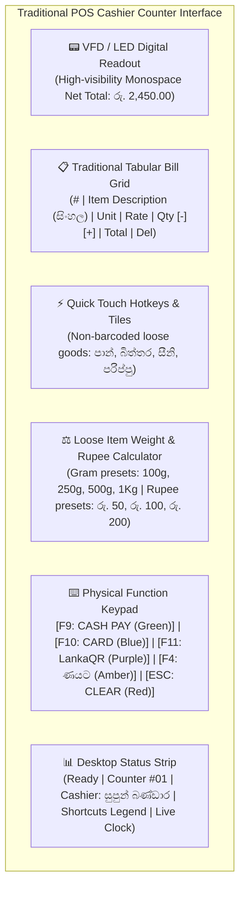
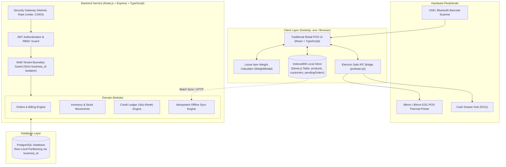
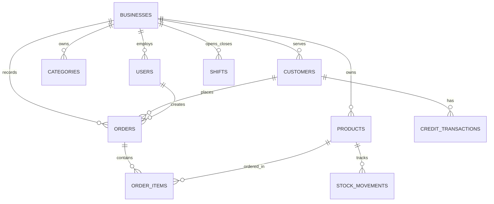

# FlexiPOS 🛒🇱🇰
### *A Customizable, Offline-First Commercial Retail POS Platform for Sri Lankan Businesses (Grocery First)*

[](#)
[](#)
[](#)
[-slate.svg)](#)
[](#)

---

## 📌 Executive Summary

**FlexiPOS** is a high-performance, commercial-grade Point-of-Sale (POS) and retail inventory platform built specifically for small-to-medium retail businesses in Sri Lanka, starting with **grocery stores (සිල්ලර කඩවල්), mini-marts, boutique shops, and wholesale counters**.

Unlike generic web-based templates that feel like modern mobile apps or AI mockups, FlexiPOS is built around the **traditional, tactile, high-density desktop counter experience** that cashiers and store owners in Sri Lanka have trusted for decades (similar to NCR, Casio, Toshiba, and Invenova POS systems), enhanced with modern offline-first data sync and multi-tenant cloud capability.

> **Core Philosophy:**  
> *"A POS that adapts to the way Sri Lankan shops operate in reality—handling loose un-barcoded goods, digital ණය පොත (credit books), frequent power/internet cuts, and lightning-fast cashier keyboard input."*

---

## 🖥️ Dual-Mode Execution: Web POS & Native Windows Desktop App

FlexiPOS runs simultaneously in two modes from a single unified codebase:

1. **Native Windows Desktop POS App (`FlexiPOS.exe`)**:
   - Built on Electron with custom CJS preloading and hardened IPC security.
   - **Direct Hardware Integration:** Silent raw ESC/POS thermal receipt printing (58mm / 80mm USB & network printers) without OS print dialogue delays.
   - **Offline Standalone Execution:** Instant launch from local disk without needing an active browser, internet connection, or external terminal process.
   - **Native Window & Kiosk Controls:** True fullscreen cashier mode, minimize, maximize, and hardware cash-drawer kick support.

2. **Web POS (Browser Mode)**:
   - High-performance React 18 + Vite + TypeScript web interface accessible from tablets, secondary counters, or owner laptops via local LAN (`http://localhost:5173`).

---

## 🏪 Traditional Retail POS Interface (Zero AI Gimmicks)

Sri Lankan shopkeepers and counter cashiers require high-contrast, anti-fatigue, structured interfaces rather than modern, bubbly mobile layouts. FlexiPOS features:



### Key UI Features:
1. **LED / VFD Customer Digital Display:** High-visibility green-on-black digital display showing active `NET TOTAL DUE`, item count, and tender change.
2. **Tabular POS Invoice Grid:** Numbered lines, Sinhala/English titles, unit rates, quantity controls, and delete triggers.
3. **Dedicated Loose Item Weight Engine ([WeightModal.tsx](file:///d:/project/Pos System/Genaral/src/client/components/WeightModal.tsx)):** Instant grams-to-rupees and rupees-to-grams reverse calculation (e.g., customer asks for "රු. 100 ක සීනි" or "පරිප්පු 250g").
4. **Physical-Style Color Coded Action Keys:**
   - **[F9 / PAY]:** Cash payment settlement with automatic change calculation.
   - **[F10 / CARD]:** POS card machine integration.
   - **[F11 / LankaQR]:** Dynamic LankaQR display for instant bank app payments (Commercial Bank, BOC, Sampath, Frimi, iPay, etc.).
   - **[F4 / ණයට]:** Direct checkout to customer credit ledger.
   - **[ESC / CLEAR]:** Void active bill with safety verification.
5. **Traditional Counter PIN Pad Login:** Touch-enabled 0–9 physical keypad for cashier sign-in.

---

## 💼 Business & Commercial Model

FlexiPOS operates on a **Core SaaS Subscription + Paid Customization** model. Every merchant is provisioned within a secure multi-tenant environment with tenant isolation.

| Tier | Monthly Fee (LKR) | Target Segment | Included Modules |
| :--- | :--- | :--- | :--- |
| **Basic** | **Rs. 1,500 – 2,500** | Small village grocery, single counter, 100–500 items | Fast billing, inventory tracking, thermal receipts, basic daily sales |
| **Standard** | **Rs. 3,000 – 5,000** | Busy mini-mart, multiple staff, 1,000+ items | All Basic + **ණය පොත (Credit Ledger)**, Supplier management, Cashier shifts, Low-stock alerts |
| **Custom Enterprise** | **Quotation Basis** | Multi-branch, wholesale + retail, custom workflows | Multi-branch sync, wholesale dual pricing, custom reports, priority setup |

---

## 🔍 Sri Lankan Market Validation & Competitive Edge

| Competitor | Public Pricing | FlexiPOS Differentiator |
| :--- | :--- | :--- |
| **Invenova** | From Rs. 3,500/mo | Tactile keyboard hotkeys, instant loose weighing, zero-latency desktop offline engine |
| **Vexel POS** | Rs. 1,500/mo + Rs. 50,000 setup fee | **No heavy upfront setup fee**; runs on existing shop PCs and laptops |
| **Sri Bill** | Rs. 4,990/mo | Tailored specifically for Sri Lankan grocery workflows at half the entry price |
| **PosEx** | Offline-first, inventory | Deep digital **ණය පොත** + loose grocery weighing (සහල්/එළවළු/සීනි) |

---

## 🏛️ System Architecture

FlexiPOS is constructed as an **Offline-First Modular Monolith**:



---

## 🗄️ Database Architecture & Multi-Tenancy

Every database table strictly enforces tenant isolation via `business_id` (UUIDv4).



---

## 🔄 Idempotent Offline Synchronization Protocol

1. **Client-Side UUIDv4 Generation:** Sales are generated with unique IDs on the local terminal (`localDb.pendingOrders`).
2. **Instant Local Stock & Balance Deduction:** Cashiers experience 0-second billing latency; local stock and credit balances drop immediately.
3. **Idempotent Upsert:** When connectivity restores, batch payloads sync via `POST /api/v1/sync/orders`. Conflicts are resolved with `ON CONFLICT (id) DO NOTHING`.

---

## 🔒 Security Hardening & Penetration Testing

- **Helmet Security Headers:** Content Security Policy, XSS filter, DNS prefetch control, and frame-guard enabled.
- **Express Rate Limiting:** Brute-force protection on authentication and payment endpoints (100 reqs / 15 mins).
- **Strict IDOR Mitigation:** All product and customer queries in `orders.service.ts` enforce composite tenant queries:
  ```typescript
  await tx.product.findFirst({ where: { id: item.productId, businessId } });
  ```
- **Sanitized Error Responses:** Stack traces and internal database errors are sanitized in production environments.

---

## 🚀 Running FlexiPOS

### Prerequisites
- Node.js 18+ & npm
- PostgreSQL running locally or in cloud (Default: `127.0.0.1:5432`)

### 1. Run Native Windows Desktop App (Standalone Executable)
No terminal or development server required:
```text
release\win-unpacked\FlexiPOS.exe
```

### 2. Run Desktop App in Development Mode (Live Hot Reloading)
```powershell
npm run dev:electron
```

### 3. Run Web POS Mode (Browser)
```powershell
# Start Vite frontend (http://localhost:5173)
npm run dev:client

# Start Express Backend API (http://localhost:5000)
npm run dev:server
```

### 4. Build & Package Executables
```powershell
# Build standalone unpacked Windows application (release/win-unpacked/FlexiPOS.exe)
npm run pack:desktop

# Build complete Windows NSIS desktop installer
npm run build:desktop
```

---

## 🔑 Default Demo Credentials

| Role | Username | Password / PIN | Permissions |
| :--- | :--- | :--- | :--- |
| **Cashier** | `cashier1` | `1234` | Billing, Barcode Scan, Weight Entry, Receipt Print, Credit Book selection |
| **Shop Admin** | `owner` | `1234` | Inventory, Stock Adjustments, Credit Repayments, Sales History, Staff |
| **Super Admin** | `superadmin` | `admin` | Tenant Shop onboarding, Plan allocation, Platform Master Control |

---

## 📂 Project Structure

```text
FlexiPOS/
├── release/                      # Packaged Windows Desktop Executable (win-unpacked/FlexiPOS.exe)
├── prisma/                       # Prisma ORM schema & PostgreSQL migrations
├── src/
│   ├── client/                   # Traditional Retail POS Frontend (React + Vite + TypeScript)
│   │   ├── components/           # Traditional Counter Components
│   │   │   ├── CartTable.tsx     # Tabular Bill Grid + VFD Display + Physical Keypad
│   │   │   ├── QuickItemTiles.tsx# Non-barcoded loose item touch buttons
│   │   │   ├── ProductCatalog.tsx# Barcode scanning & search catalog
│   │   │   ├── WeightModal.tsx   # Grams/Kg & Rupee reverse loose item calculator
│   │   │   ├── CheckoutModal.tsx # Multi-tender settlement (Cash, Card, LankaQR, Credit)
│   │   │   ├── CreditBookModal.tsx# Digital ණය පොත customer ledger & repayments
│   │   │   ├── ReceiptModal.tsx  # Thermal receipt print preview (58mm/80mm)
│   │   │   ├── Header.tsx        # Top Desktop Window Bar & Navigation Toolbar
│   │   │   ├── admin/            # Shop Owner Back-office Panel
│   │   │   ├── auth/             # Traditional Cashier Keypad Login Screen
│   │   │   └── superadmin/       # Multi-Tenant SaaS Master Panel
│   │   ├── db/                   # Dexie.js IndexedDB schema & sync queues
│   │   └── i18n/                 # 1-Click Sinhala / English bilingual dictionary
│   ├── desktop/                  # Electron Main Process & Preload Bridge
│   │   ├── main.cjs              # Desktop lifecycle, hardware print handler, window state
│   │   └── preload.cjs           # Secure context-bridge exposing window.electronAPI
│   └── server/                   # Backend Modular Monolith API (Express + TypeScript)
│       ├── modules/              # Domain services (auth, business, customers, orders, products, sync)
│       └── middleware/           # TenantGuard, JWT RBAC, RateLimiter, ErrorHandler
├── electron-builder.json         # Windows executable packaging configuration
└── package.json                  # Project dependencies and operational scripts
```

---

## 📄 License & Commercial Distribution

FlexiPOS is a proprietary commercial software platform developed for Sri Lankan retail enterprises. All rights reserved.
