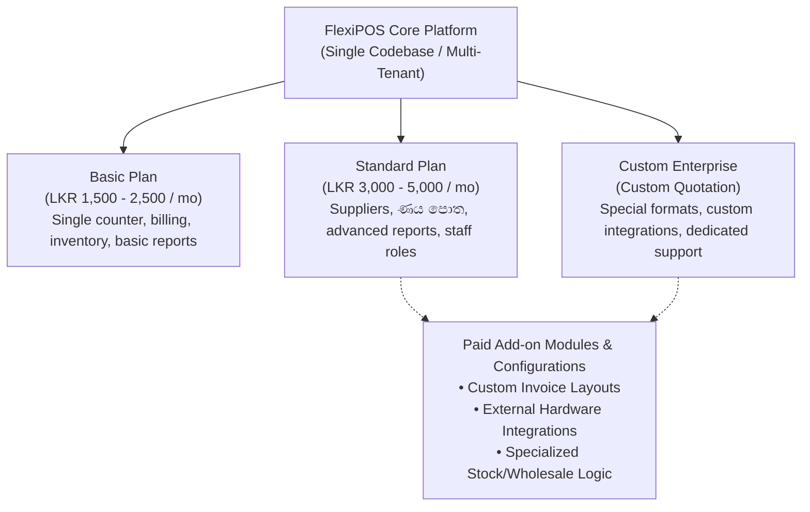
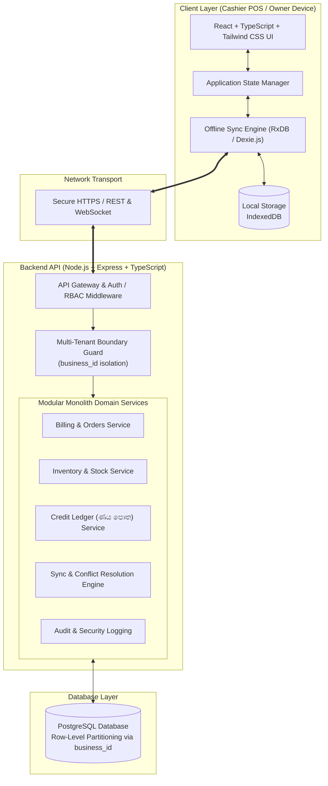
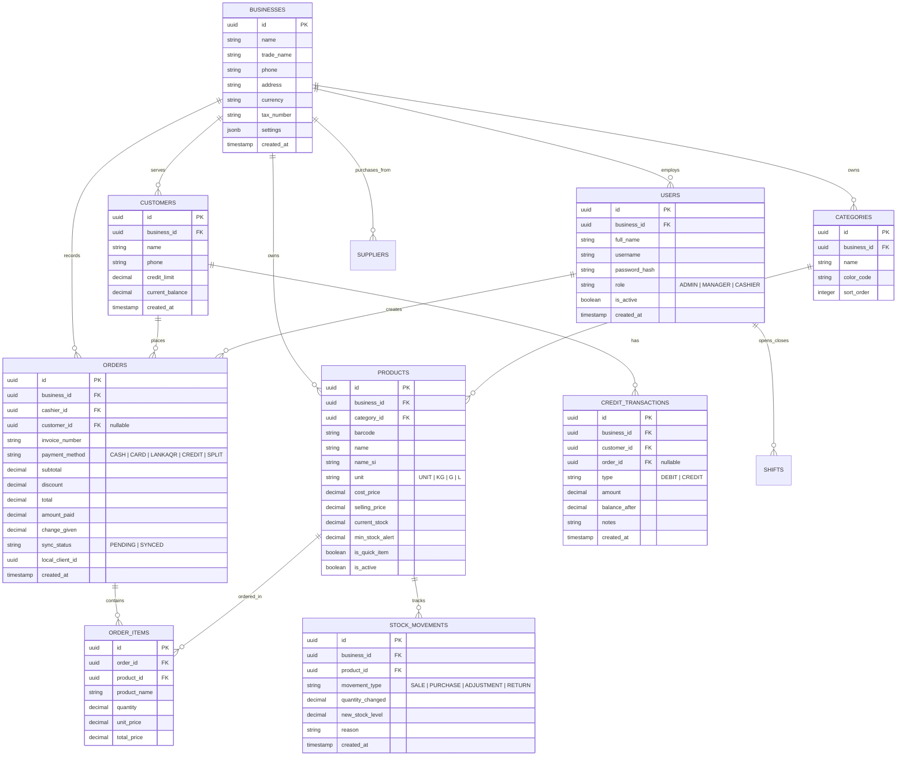
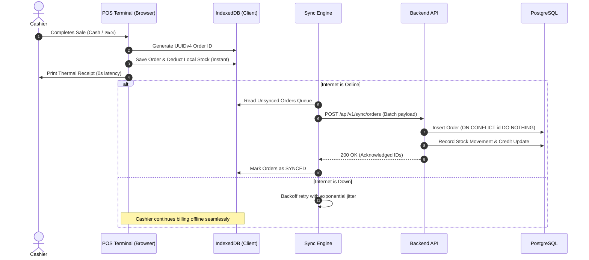
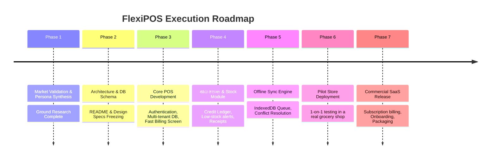

# FlexiPOS 🛒🇱🇰
### *A Customizable, Offline-First POS Platform for Sri Lankan Small Businesses (Grocery First)*

[](#)
[](#)
[](#)
[](#)

---

## 📌 Executive Summary

**FlexiPOS** is an enterprise-ready, customizable Point-of-Sale (POS) and retail management platform built specifically for small-to-medium retail businesses in Sri Lanka, starting with **grocery stores, boutique shops, and mini-marts**.

Unlike rigid, generic legacy POS systems, FlexiPOS operates on a core philosophy:
> **"A POS that adapts to the way each shop operates, instead of forcing every shop to work the same way."**

---

## 💼 Business & Commercial Model

FlexiPOS follows a **Core Subscription + Paid Customization** SaaS model. Every customer shares a single, secure multi-tenant codebase with feature flags and dynamic configuration.



### Proposed Pricing Tiers

| Tier | Monthly Fee (LKR) | Target Segment | Key Modules Included |
| :--- | :--- | :--- | :--- |
| **Basic** | **Rs. 1,500 – 2,500** | Small village grocery, single counter, 100–500 items | Fast billing, inventory tracking, basic daily sales, thermal receipts |
| **Standard** | **Rs. 3,000 – 5,000** | Busy mini-mart, multiple staff, 1,000+ items | All Basic + **ණය පොත (Credit Ledger)**, Supplier management, Cashier shifts, Low stock alerts |
| **Custom Business** | **Quotation Basis** | Multi-branch, wholesale + retail, custom workflows | Multi-branch sync, wholesale pricing tiers, custom reports, priority setup |

---

## 🔍 Sri Lankan Market Validation & Competitive Edge

A comparative evaluation of existing solutions in the Sri Lankan market reveals clear opportunities:

| Competitor | Public Features / Pricing | FlexiPOS Competitive Edge |
| :--- | :--- | :--- |
| **Invenova** | Stock, credit, supplier; Starter from Rs. 3,500/mo | Simpler UI, instant non-barcode touch items, zero setup friction |
| **Vexel POS** | Offline, barcode, credit; Rs. 1,500/mo + Rs. 50,000 setup fee | **No heavy upfront setup fee**; runs on existing hardware/tablets |
| **Sri Bill** | Billing, inventory, weighted items; Rs. 4,990/mo | Tailored specifically for Sri Lankan grocery workflows at half the entry price |
| **Goko POS** | Sinhala/Tamil support, free plan advertised | Robust offline synchronization with strict multi-tenant security & audit logs |
| **PosEx** | Offline-first, multi-device, inventory | Deep focus on digital **ණය පොත** + loose grocery weighing (සහල්/එළවළු) |

### Key Differentiators:
1. **Digital ණය පොත (Customer Credit Ledger):** Built directly into the checkout flow. No separate accounting software required.
2. **Lightning Fast Loose/Weighted Item Entry:** Barcodes are not universal in Sri Lanka. One-touch hotkeys for un-barcoded goods (bread, eggs, bulk rice, sugar).
3. **True Offline-First Architecture:** Uninterrupted sales during fiber/4G drops or power cuts. Data queues locally and synchronizes automatically with conflict prevention.
4. **Low Hardware Barrier:** Runs cleanly on budget hardware (refurbished Core i3 laptops, Android tablets, 58mm/80mm USB/Bluetooth thermal printers).

---

## 👥 Target Customer Segments

```mermaid
journey
    title Customer Expansion Journey
    section Tier A: Small Grocery Shops
      1 Cashier / Owner operated: 5: Small Grocery
      100 - 1,000 items (Rice, Spices, Loose goods): 5: Small Grocery
      Paper ණය පොත replacement: 5: Small Grocery
    section Tier B: Mini Marts & Self-Service
      Barcode scanning & 2 Cashiers: 4: Mini Mart
      Expiry date & supplier purchase orders: 4: Mini Mart
      Cashier shift management (Z-Reports): 4: Mini Mart
    section Tier C: Multi-Branch Chains
      Central stock warehouse: 3: Multi-Branch
      Inter-branch transfers: 3: Multi-Branch
      Consolidated owner financial dashboard: 3: Multi-Branch
```

* **Tier A (Primary Launch Target):** Single-counter family grocers. Priority: Extreme simplicity, speed, credit book.
* **Tier B (Scale Target):** Semi-modern mini-marts with barcode readers, multiple staff, and high inventory volume.
* **Tier C (Future Horizon):** 2–5 branch local chains requiring consolidated stock and reporting.

---

## 🚀 Product Scope & Feature Matrix

### V1 — Essential Launch Scope
* **POS Checkout:**
  * Ultra-fast item search and barcode scanning.
  * Quick-touch tiles for loose / non-barcoded items (පාන්, බිත්තර, සීනි, සහල්).
  * Weighted item entry (price-per-kg with instant gram/kilogram calculation).
  * Item-level and bill-level discounts.
  * Split payments: Cash, Card, LankaQR, and **ණයට (Credit)**.
  * Thermal receipt printing (58mm and 80mm ESC/POS format).
* **Inventory & Stock Management:**
  * Product catalogue (Barcode, Name, Category, Cost Price, Selling Price, Minimum Reorder Level).
  * Stock-in (GRN) and manual stock adjustments (spoilage/damage).
  * Low-stock warnings.
* **Customer Management & ණය පොත (Credit Ledger):**
  * Customer profile with credit limit and phone number.
  * 1-click credit checkout with existing balance display.
  * Partial credit repayment recording with instant updated balance.
* **User Management & Security:**
  * Role-Based Access Control (Admin / Owner, Cashier).
  * Cashier shift closing (X/Z Report) with physical cash tally.
* **Offline Billing Engine:**
  * Uninterrupted sales when offline using IndexedDB.
  * Auto-syncing background engine when internet returns.

### V1.5 — Advanced Features
* Expiry date tracking and near-expiry alerts.
* Excel / CSV bulk product import & export.
* Expense tracking (electricity, shop rent, tea/staff expenses).
* Owner Mobile Dashboard (real-time sales from outside the shop).

### V2 — Enterprise & Custom Modules
* Multi-branch stock transfers.
* Wholesale dual-pricing (Retail price vs. Wholesale / Box price).
* SMS / WhatsApp payment reminders for credit customers.
* IRD RAMIS compliance (Electronic VAT invoice integration).

---

## 🏛️ System Architecture

FlexiPOS is designed as a **Modular Monolith** with an **Offline-First Client Layer**.



### Technology Stack

| Layer | Technology | Justification |
| :--- | :--- | :--- |
| **Frontend UI** | **React (Vite) + TypeScript** | High performance, rapid rendering for fast typing cashiers |
| **Styling** | **Tailwind CSS** | Clean, responsive UI tailored for both touchscreens & keyboards |
| **Local Client DB** | **IndexedDB (via Dexie.js)** | Robust client-side database capable of holding 10,000+ cached items and pending sales |
| **Backend Runtime** | **Node.js + Express (TypeScript)** | Lightweight, scalable, modular, and fast I/O |
| **Database** | **PostgreSQL** | ACID-compliant transactional guarantees for financial ledgers and stock counts |
| **Data Validation** | **Zod** | End-to-end type safety shared between client and server |
| **Receipt Printing** | **Web Print API / ESC-POS** | Direct raw thermal printer integration (USB/Bluetooth/Network) |

---

## 🗄️ Database Architecture & Entity Relationship Diagram (ERD)

All tables strictly enforce multi-tenancy via a foreign key `business_id`. 



---

## 🔄 Offline Synchronization Protocol

To ensure sales never halt during network failures, FlexiPOS employs an **Append-Only Idempotent Sync Protocol**:



### Key Sync Guarantees:
1. **Client-Side UUIDs:** Every transaction is tagged with a UUIDv4 on the terminal. Even if network packets retransmit, the server ignores duplicates using `ON CONFLICT (id) DO NOTHING`.
2. **Immutable Ledgers:** Sales and credit repayments are append-only rows. They never overwrite past entries.
3. **Optimistic Stock Deduction:** Local terminal inventory drops immediately for cashier awareness; reconciliation occurs when connected.

---

## 🇱🇰 Sri Lankan Localizations & Regulatory Standards

1. **Currency & Fractions:** Strict Sri Lankan Rupee formatting (`LKR` / `රු.`), rounding rules to 2 decimal places.
2. **Sinhala & Tamil Script Ready:** Database fields support Unicode UTF-8 (`name_si`, `name_ta`) allowing receipt printing in native languages.
3. **LankaQR Support:** Dynamic QR display on terminal or receipt allowing instant settlement via any Sri Lankan bank app (Commercial Bank, BOC, Sampath, Frimi, Genie, iPay).
4. **Thermal Receipt Printing:** Tailored for low-cost 58mm (2-inch) and 80mm (3-inch) ESC/POS thermal printers.
5. **IRD RAMIS Preparation:** Architecture leaves clean hook points for VAT-registered stores to interface with Inland Revenue Department (IRD) electronic VAT invoicing requirements.

---

## 📅 Development Roadmap & Milestones



---

## 🛠️ Project Structure

```text
FlexiPOS/
├── docs/                     # Specifications, architectural diagrams, API contracts
├── src/
│   ├── client/               # React + TypeScript + Tailwind POS UI
│   │   ├── components/       # POS Billing, Numpad, Quick Tiles, Modals
│   │   ├── hooks/            # useOfflineSync, useBarcodeScanner, useCart
│   │   ├── db/               # Dexie.js IndexedDB schema & sync queues
│   │   └── utils/            # ESC-POS receipt generator, LKR formatters
│   ├── server/               # Node.js + Express + TypeScript Backend
│   │   ├── modules/          # Business logic (billing, credit, stock, auth)
│   │   ├── middleware/       # Tenant isolation, JWT auth, audit logging
│   │   └── db/               # PostgreSQL connection & Prisma / DDL migrations
│   └── shared/               # Shared TypeScript types, Zod schemas, constants
├── README.md                 # Primary Master Documentation
└── package.json              # Monorepo dependencies and scripts
```

---

## 📄 License & Commercial Distribution

FlexiPOS is developed as a proprietary commercial software platform. All rights reserved. Custom configurations and core subscription licenses are governed under FlexiPOS commercial agreements.

