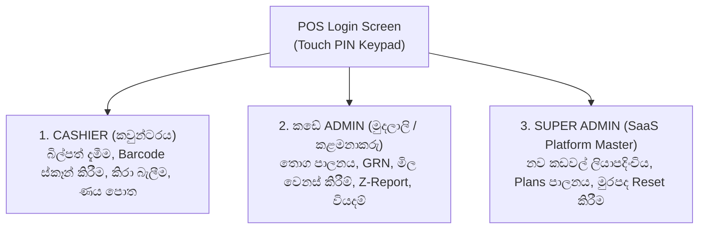

# FlexiPOS 🛒🇱🇰 - පරිශීලක අත්පොත (User Manual)
### *A Complete Step-by-Step Guide for Sri Lankan Retailers, Store Owners & Cashiers*

---

## 📑 පටුන (Table of Contents)

1. [හැඳින්වීම සහ පද්ධතිය ආරම්භ කිරීම (Getting Started)](#1-හැඳින්වීම-සහ-පද්ධතිය-ආරම්භ-කිරීම-getting-started)
2. [පද්ධතියට පිවිසීම (System Login & Roles)](#2-පද්ධතියට-පිවිසීම-system-login--roles)
3. [විකුණුම් කවුන්ටරය භාවිතය (Cashier POS Counter Screen)](#3-විකුණුම්-කවුන්ටරය-භාවිතය-cashier-pos-counter-screen)
4. [කිරා මැන බලන බඩු විකිණීම (Loose Item Weight & Rupee Calculator)](#4-කිරා-මැන-බලන-බඩු-විකිණීම-loose-item-weight--rupee-calculator)
5. [ගෙවීම් බේරුම්කරණය (Checkout & Payment Methods)](#5-ගෙවීම්-බේරුම්කරණය-checkout--payment-methods)
6. [ඩිජිටල් ණය පොත භාවිතය (Customer Credit Ledger - ණය පොත)](#6-ඩිජිටල්-ණය-පොත-භාවිතය-customer-credit-ledger---ණය-පොත)
7. [රිසිට්පත් මුද්‍රණය (Thermal Receipt Printing)](#7-රිසිට්පත්-මුද්‍රණය-thermal-receipt-printing)
8. [කඩේ පරිපාලක පුවරුව (Shop Admin Back-Office Panel)](#8-කඩේ-පරිපාලක-පුවරුව-shop-admin-back-office-panel)
9. [දෛනික Z-Report සහ මාරුව අවසන් කිරීම (Cashier Shift Closing)](#9-දෛනික-z-report-සහ-මාරුව-අවසන්-කිරීම-cashier-shift-closing)
10. [දෛනික වියදම් කළමනාකරණය (Expense Tracking)](#10-දෛනික-වියදම්-කළමනාකරණය-expense-tracking)
11. [Excel / CSV දත්ත පිටපත් කරගැනීම (Data Export)](#11-excel--csv-දත්ත-පිටපත්-කරගැනීම-data-export)
12. [Super Admin Platform Master (SaaS Developer)](#12-super-admin-platform-master-saas-developer)
13. [කීබෝඩ් කෙටිමං සටහන (Keyboard Shortcuts Master Reference)](#13-කීබෝඩ්-කෙටිමං-සටහන-keyboard-shortcuts-master-reference)
14. [නිතර අසන ප්‍රශ්න සහ ගැටළු නිරාකරණය (Troubleshooting & FAQs)](#14-නිතර-අසන-ප්‍රශ්න-සහ-ගැටළු-නිරාකරණය-troubleshooting--faqs)

---

## 1. හැඳින්වීම සහ පද්ධතිය ආරම්භ කිරීම (Getting Started)

FlexiPOS යනු ශ්‍රී ලංකාවේ සිල්ලර වෙළඳසැල් (Grocery Stores), Mini Marts, සහ තොග වෙළඳුන් සඳහාම විශේෂයෙන් නිර්මාණය කරන ලද, අන්තර්ජාලය නොමැතිව වුවද (Offline-First) බාධාවකින් තොරව ක්‍රියාත්මක වන පරිගණක ගත විකුණුම් පද්ධතියකි (POS System).

FlexiPOS ක්‍රම දෙකකින් ක්‍රියාත්මක කළ හැක:

### ක්‍රමය 1: Native Windows Desktop App එකෙන් (පහසුම ක්‍රමය)
පරිගණකයේ Terminal හෝ Command Prompt කිසිවක් විවෘත නොකර කෙලින්ම පහත file එක මත Double Click කරන්න:
```text
release\win-unpacked\FlexiPOS.exe
```
> **වාසිය:** අන්තර්ජාලය නැතත් ක්ෂණිකව Desktop Window එකක් ලෙස විවෘත වේ. Thermal Receipt Printers සමඟ සෘජුවම (Direct ESC/POS) සම්බන්ධ වේ.

### ක්‍රමය 2: Web Browser එකෙන් (Local Network / Tablets සඳහා)
කඩේ ඇති Tablets, Mobile Phones හෝ වෙනත් පරිගණක මඟින් LAN ජාලය හරහා සම්බන්ධ වීමට:
1. Terminal එකේ `npm run dev:client` සහ `npm run dev:server` run කරන්න.
2. Browser එකෙන් `http://localhost:5173` වෙත පිවිසෙන්න.

---

## 2. පද්ධතියට පිවිසීම (System Login & Roles)

FlexiPOS විවෘත කළ විට සම්ප්‍රදායික POS PIN Keypad තිරයක් දිස්වේ. මෙහිදී කාර්යභාරයන් 3ක් පවතී:



### පද්ධතියේ පෙරනිමි පිවිසුම් තොරතුරු (Default Logins)

| භූමිකාව (Role) | Username | Password / PIN | අරමුණ |
| :--- | :--- | :--- | :--- |
| **Cashier (කවුන්ටරය)** | `cashier1` | `1234` | සාමාන්‍ය බිල්පත් දැමීම පමණි. සැකසුම් වෙනස් කළ නොහැක. |
| **කඩේ Admin (මුදලාලි)** | `owner` | `1234` | කඩේ මුළු පාලනය, තොග වෙනස් කිරීම, වාර්තා, වියදම්. |
| **Super Admin (Platform)**| `superadmin` | `admin` | පද්ධති සංවර්ධකයාට සියලුම කඩවල් පාලනයට. |

> **ඉක්මන් පිවිසුම (1-Click Quick Demo):** පරීක්ෂා කිරීම සඳහා Login තිරයේ පහළ ඇති `🟢 Cashier`, `🔵 කඩේ Admin`, `🟠 Super Admin` බොත්තම් මත ක්ලික් කිරීමෙන් ක්ෂණිකව පිවිසිය හැක.

---

## 3. විකුණුම් කවුන්ටරය භාවිතය (Cashier POS Counter Screen)

විකුණුම් කවුන්ටරය (F1) කොටස් 3කින් සමන්විත වේ:

```text
+---------------------------------------------------------------------------------------+
|  [F1: POS]   [F4: ණය පොත]   [F10: Admin]   |  ක්‍රියාකරු: සුපුන් බණ්ඩාර  |  [සිංහල / ENG]  |
+-----------------------------------------------------------+---------------------------+
|                                                           |  REGISTER #01   NET DUE   |
|   ⚡ QUICK TOUCH HOTKEYS (Barcode නැති භාණ්ඩ)             |       රු. 2,450.00        |
|   +-----------+ +-----------+ +-----------+ +-----------+ |---------------------------|
|   |   පාන්    | |  බිත්තර   | |  සීනි (Kg)| | පරිප්පු(Kg)| |  පාරිභෝගිකයා: සාමාන්‍ය     |
|   +-----------+ +-----------+ +-----------+ +-----------+ |---------------------------|
|                                                           | # | භාණ්ඩය | Rate|Qty|Total|
|   🔍 BARCODE SCANNER & ITEM CATALOG [F2]                  | 1 | පාන්   | 140 | 2 | 280 |
|   +-----------------------------------------------------+ | 2 | සීනි   | 260 |0.5| 130 |
|   | Barcode ස්කෑන් කරන්න හෝ නම ලියන්න...         [Enter]| |---------------------------|
|   +-----------------------------------------------------+ | Subtotal:        රු. 410  |
|   | [සියල්ල] | [බඩු බාහිරාදිය] | [බිස්කට්] | [සහල්/ධාන්‍ය]| | වට්ටම්:           රු. 00  |
|   | • Munchee Super Cream Cracker 490g      රු. 460.00  | | Net Total:       රු. 410  |
|   | • Anchor Full Cream Milk Powder 400g   රු. 1,150.00  | |---------------------------|
|   | • Maliban Chocolate Biscuit 100g        රු. 120.00  | | [F9: මුදල් ගෙවීම (CASH)]  |
|   +-----------------------------------------------------+ | [F10: CARD]  [F11: LANKAQR|
|                                                           | [F4: ණයට]    [ESC: CLEAR] |
+-----------------------------------------------------------+---------------------------+
| 🟢 READY | COUNTER-01 | SHORTCUTS: [F2] Search | [F4] ණය පොත | [F9] Pay | 2026-11-03 14:30 |
+---------------------------------------------------------------------------------------+
```

### 1. Barcode ස්කෑන් කිරීමෙන් භාණ්ඩ එක් කිරීම (Hands-Free Barcode Scanning)
- කීබෝඩ් එකේ **F2** ඔබන්න හෝ සෙවුම් කොටුවට Barcode Scanner එක එල්ල කර ස්කෑන් කරන්න.
- Scanner එකෙන් Barcode එක ලැබුණු සැනින් කිසිදු mouse click එකක් නොමැතිව භාණ්ඩය කෙලින්ම බිලට එකතු වේ!

### 2. Barcode නැති සුලභ භාණ්ඩ එක් කිරීම (Quick Touch Tiles)
- පාන්, බිත්තර, සීනි, පරිප්පු, පොල් වැනි Barcode නැති භාණ්ඩ ඉහළ ඇති **Quick Touch Tiles** මත එක ක්ලික් එකකින් බිලට එක් කළ හැක.

### 3. බිලෙහි ප්‍රමාණයන් වෙනස් කිරීම (Quantity Adjustment)
- බිලෙහි ඇති ඕනෑම භාණ්ඩයක ප්‍රමාණය වැඩි කිරීමට `[+]` බොත්තම ද, අඩු කිරීමට `[-]` බොත්තම ද ඔබන්න.
- භාණ්ඩය සම්පූර්ණයෙන්ම බිලෙන් ඉවත් කිරීමට දකුණු පස ඇති කුණු බක්කියේ රූපය `[Del]` ඔබන්න.

### 4. සම්පූර්ණ බිල අවලංගු කිරීම (Void / Clear Bill)
- කීබෝඩ් එකේ **ESC** හෝ රතු පැහැති `[බිල අවලංගුයි (CLEAR / ESC)]` බොත්තම එබීමෙන් බිල මුල සිට හිස් කළ හැක.

---

## 4. කිරා මැන බලන බඩු විකිණීම (Loose Item Weight & Rupee Calculator)

ශ්‍රී ලංකාවේ සිල්ලර කඩවල සීනි, සහල්, පරිප්පු, අල, ළූණු, එළවළු ආදිය විකුණන්නේ කිරා මැන බැලීමෙනි. ඒ සඳහා FlexiPOS සතුව විශේෂිත **Weight & Rupee Calculator** එකක් ඇත.

සීනි, සහල් හෝ පරිප්පු වැනි කිලෝ ග්‍රෑම් (Kg/G) වලින් මනින භාණ්ඩයක් මත ක්ලික් කළ විට ස්වයංක්‍රීයව මෙම කැල්කියුලේටරය විවෘත වේ:

### ක්‍රමය A: බර අනුව විකිණීම (By Weight - Grams / Kg)
- පාරිභෝගිකයා ඉල්ලන බර ප්‍රමාණය (`0.250`, `0.500`, `1.500`) ඇතුළත් කරන්න.
- නැතහොත් ක්ෂණික බර බොත්තම් ඔබන්න:  
  `[100g]` `[250g]` `[500g]` `[1.0 Kg]` `[2.0 Kg]` `[5.0 Kg]`
- අයකළ යුතු මුදල ක්ෂණිකව ගණනය වේ.

### ක්‍රමය B: මුදල අනුව විකිණීම (By Cash Amount - රුපියල් ගණනට)
- පාරිභෝගිකයා **"රුපියල් 100 ක සීනි දෙන්න"** හෝ **"රුපියල් 50 ක පරිප්පු දෙන්න"** යැයි පැවසුවහොත්:
- `💵 මුදල අනුව` ටැබ් එක තෝරා `100` ඇතුළත් කරන්න (හෝ `[රු. 50]`, `[රු. 100]`, `[රු. 200]`, `[රු. 500]` ඔබන්න).
- පද්ධතිය විසින් ඒ සඳහා දිය යුතු **නියම බර ප්‍රමාණය (Calculated Weight)** ග්‍රෑම් වලින් නිවැරදිව පෙන්වයි (උදා: රු. 100 ට සීනි ග්‍රෑම් 385).
- **[බිලට එක්කරන්න (Enter)]** එබූ විට නියමිත ගණනය කිරීම සමඟ බිලට එක්වේ.

---

## 5. ගෙවීම් බේරුම්කරණය (Checkout & Payment Methods)

භාණ්ඩ එකතු කර අවසන් වූ පසු කීබෝඩ් එකේ **F9** හෝ විශාල කොළ පැහැති **[මුදල් ගෙවීම (PAY / F9)]** බොත්තම ඔබන්න.

### 1. මුදල් ගෙවීම (CASH)
1. පාරිභෝගිකයා ලබාදුන් මුදල ඇතුළත් කරන්න (හෝ නෝට්ටු බොත්තම් ඔබන්න: `[රු. 100]`, `[රු. 500]`, `[රු. 1,000]`, `[රු. 5,000]`, `[Exact]`).
2. පාරිභෝගිකයාට ආපසු දිය යුතු **ඉතිරි මුදල (CHANGE DUE)** විශාල අකුරින් පෙන්වයි.
3. **[ගෙවීම සම්පූර්ණ කරන්න (CONFIRM & PRINT)]** හෝ කීබෝඩ් එකේ `Enter` ඔබන්න.
4. Cash Drawer එක විවෘත වී බිල්පත මුද්‍රණය වේ.

### 2. කාඩ්පත් ගෙවීම් (CARD / F10)
- POS Card Machine එකෙන් Card එක swipe/tap කළ පසු `CARD` තෝරා Confirm කරන්න.

### 3. LankaQR ගෙවීම් (LankaQR / F11)
- තිරයේ දිස්වන LankaQR කේතය පාරිභෝගිකයාට තම බැංකු App එකෙන් (Commercial Q+ / BOC SmartPay / Sampath WePay / Frimi / iPay / Flash) ස්කෑන් කර ගෙවීමට කියන්න. ගෙවීම තහවුරු වූ පසු Confirm කරන්න.

### 4. ණයට විකිණීම (CREDIT / F4)
- පාරිභෝගිකයා ණයට භාණ්ඩ ලබාගන්නේ නම් `CREDIT` තෝරන්න.
- *(සැලකිය යුතුයි: ණයට දීමට පෙර අනිවාර්යයෙන්ම පාරිභෝගිකයෙකු තෝරාගෙන තිබිය යුතුය).*

---

## 6. ඩිජිටල් ණය පොත භාවිතය (Customer Credit Ledger - ණය පොත)

ලංකාවේ සිල්ලර වෙළඳසැල් වල පැරණි කඩදාසි ණය පොත වෙනුවට ආරක්ෂිත ඩිජිටල් ණය පොතක් FlexiPOS සතු වේ. ඕනෑම වෙලාවක **F4** එබීමෙන් මෙය විවෘත කළ හැක.

### 1. නව ණය පාරිභෝගිකයෙකු ඇතුළත් කිරීම
1. ණය පොතේ `+ නව පාරිභෝගිකයෙකු ඇතුළත් කිරීම` ටැබ් එකට යන්න.
2. පාරිභෝගිකයාගේ සම්පූර්ණ නම, දුරකථන අංකය සහ උපරිම ණය සීමාව (Credit Limit) ඇතුළත් කර **[සුරකින්න]** ඔබන්න.

### 2. පාරිභෝගිකයෙකුගේ බිලකට ණය දැමීම
1. විකුණුම් තිරයේදී **F4** ඔබා අදාළ පාරිභෝගිකයා ඉදිරියෙන් ඇති **[තෝරන්න]** ඔබන්න.
2. සාමාන්‍ය පරිදි බිල දමා Checkout එකේදී `CREDIT` තෝරා Confirm කරන්න.
3. පාරිභෝගිකයාගේ පැරණි ණය ශේෂයට අලුත් බිලේ මුදල එකතු වී ක්ෂණිකව ශේෂය යාවත්කාලීන වේ.

### 3. ණය පියවීම් / මුදල් භාරගැනීම (Credit Repayment)
1. පාරිභෝගිකයා ණය ගෙවීමට පැමිණි විට ණය පොතෙන් (F4) ඔහුගේ නම සොයන්න.
2. **[ගෙවීම් භාරගැනීම]** බොත්තම ඔබන්න.
3. පාරිභෝගිකයා ගෙවන මුදල ඇතුළත් කර **[Confirm Repayment]** ඔබන්න.
4. පාරිභෝගිකයාගේ ණය මුදලින් එම මුදල අඩු වන අතර, ලාච්චුවේ මුදල් ප්‍රමාණය වැඩි වේ.
5. පාරිභෝගිකයාට නව ණය ශේෂය දැක්වෙන **ණය ගෙවීමේ රිසිට්පතක් (Repayment Slip)** නිකුත් වේ.

---

## 7. රිසිට්පත් මුද්‍රණය (Thermal Receipt Printing)

FlexiPOS ලංකාවේ බහුලව ඇති ඕනෑම USB හෝ Network ESC/POS Thermal Printer එකක් සමඟ (58mm - අඟල් 2 හෝ 80mm - අඟල් 3) ක්‍රියා කරයි.

- බිල අවසන් කළ සැනින් තිරය මත රිසිට්පත පෙරදසුන් වේ (Preview).
- **[මුද්‍රණය කරන්න (Print)]** එබූ විට හෝ Auto-print සක්‍රීය කර ඇත්නම් ස්වයංක්‍රීයව බිල මුද්‍රණය වේ.
- රිසිට්පතේ වෙළඳසැලේ නම (සිංහලෙන් සහ English වලින්), ලිපිනය, දුරකථන අංකය, බිල්පත් අංකය, භාණ්ඩ ලැයිස්තුව, මුදල්/ඉතිරි සහ LankaQR කේතය මුද්‍රණය වේ.

---

## 8. කඩේ පරිපාලක පුවරුව (Shop Admin Back-Office Panel)

කඩේ මුදලාලි හෝ කළමනාකරු සඳහා වූ Back-office පුවරුවට පිවිසීමට ඉහළ ඇති **[ADMIN F10]** ඔබන්න (නැතහොත් කීබෝඩ් එකේ **F10** ඔබන්න).

### ප්‍රධාන ටැබ් 8:
1. **📊 දළ සාරාංශය (Dashboard):** අද දවසේ මුළු විකුණුම්, ලාච්චුවේ මුදල්, කඩේ මුළු ණය ප්‍රමාණය සහ අවසන් බිල්පත්.
2. **📦 භාණ්ඩ හා තොග (Inventory):** සියලුම භාණ්ඩ, විකුණුම් මිල, ගැණුම් මිල සහ පවතින තොග.
3. **📖 ණය පොත (Credit Ledger):** ණය ගැතියන්ගේ සම්පූර්ණ ලැයිස්තුව සහ ශේෂයන්.
4. **🧾 බිල්පත් ඉතිහාසය (Sales History):** නිකුත් කළ සියලුම බිල්පත් සෙවීම සහ පරීක්ෂා කිරීම.
5. **📋 Z-Report / මාරුව අවසන් කිරීම:** මුදල් ලාච්චුව ගණනය කර දවස අවසන් කිරීම.
6. **💸 වියදම් (Expenses):** කඩේ දෛනික වියදම් සටහන් කිරීම.
7. **👥 සේවකයින් (Staff Accounts):** Cashier ගිණුම් කළමනාකරණය.
8. **⚙️ සැකසුම් (Settings):** කඩේ නම, ලිපිනය, දුරකථන සහ රිසිට්පත් සැකසුම්.

### නව භාණ්ඩයක් ඇතුළත් කිරීම (Add Product)
1. `භාණ්ඩ හා තොග` ටැබ් එකට ගොස් **[+ නව භාණ්ඩයක් එක්කිරීම]** ඔබන්න.
2. නම, සිංහල නම, Barcode, මිනුම් ඒකකය (Unit: Unit / Kg / g / Packet), විකුණුම් මිල, ගැණුම් මිල සහ ආරම්භක තොගය ඇතුළත් කර සුරකින්න.
3. Barcode නැති භාණ්ඩයක් නම් "Quick Tile එකක් ලෙස පෙන්වන්න" ටික් කරන්න.

### තොග වෙනස් කිරීම් සහ GRN (Stock Adjustments)
නව තොග ලැබුණු විට හෝ හානි වූ විට:
1. අදාළ භාණ්ඩය ඉදිරියෙන් ඇති **[📦 තොග වෙනස් කරන්න]** ඔබන්න.
2. එකතු වන ප්‍රමාණය ධන අගයක් ලෙසද (`+20`), හානි වූයේ නම් සෘණ අගයක් ලෙසද (`-2`) ඇතුළත් කරන්න.
3. හේතුව තෝරන්න (නව තොග ලැබීම / හානි වීම / කල් ඉකුත් වීම / ගණන් කිරීමේ නිවැරදි කිරීම්) සහ තහවුරු කරන්න.

---

## 9. දෛනික Z-Report සහ මාරුව අවසන් කිරීම (Cashier Shift Closing)

කඩය වසන වේලාවට හෝ Cashier මාරුව අවසන් වන විට:

1. Admin Panel එකේ **📋 Z-Report** ටැබ් එකට පිවිසෙන්න.
2. පද්ධතිය විසින් අද දවසේ මුළු විකුණුම් සහ අපේක්ෂිත මුදල් (Expected Cash) පෙන්වයි.
3. ලාච්චුවේ ඇති සැබෑ මුදල් ගණනය කර **"ලාච්චුවේ සැබවින්ම ගණනය කළ මුදල (Physical Cash Counted)"** කොටුවෙහි ඇතුළත් කරන්න.
4. පද්ධතිය විසින් මුදල් නියමිත පරිදි තුලනය වී ඇත්ද (Balanced), අතිරික්තද (Excess Cash) හෝ හිඟයක් තිබේද (Cash Shortage) යන්න පැහැදිලිව පෙන්වයි.
5. **[Z-Report මුද්‍රණය]** ඔබා දවසේ නිල Z-Report පත්‍රිකාව මුද්‍රණය කරගන්න.
6. **[මාරුව අවසන් කරන්න (Close Shift)]** ඔබා දවස අවසන් කරන්න.

---

## 10. දෛනික වියදම් කළමනාකරණය (Expense Tracking)

කඩේ දෛනික වියදම් නිවැරදිව සටහන් කර ගැනීමෙන් දවසේ සැබෑ ශුද්ධ ලාභය බලාගත හැක.

1. Admin Panel එකේ **💸 වියදම් (Expenses)** ටැබ් එකට යන්න.
2. වියදම් වර්ගය තෝරන්න (විදුලි බිල, ජල බිල, කඩ කුලිය, තේ සහ කෑම, ප්‍රවාහන, වෙනත්).
3. මුදල සහ සටහන ඇතුළත් කර **[+ එක්කරන්න]** ඔබන්න.
4. පද්ධතිය විසින් අද දවසේ මුළු විකුණුම් වලින් වියදම් අඩු කර **ඇස්තමේන්තුගත ශුද්ධ ආදායම (Net Profit)** ස්වයංක්‍රීයව ගණනය කර පෙන්වයි.

---

## 11. Excel / CSV දත්ත පිටපත් කරගැනීම (Data Export)

ඔබගේ බිල්පත් සහ භාණ්ඩ ලැයිස්තුව පරිගණකයේ Excel වලට ලබාගැනීමට:
- **භාණ්ඩ ලැයිස්තුව Download කිරීමට:** `භාණ්ඩ හා තොග` ටැබ් එකේ ඇති **[Excel / CSV Export]** බොත්තම ඔබන්න.
- **විකුණුම් වාර්තාව Download කිරීමට:** `බිල්පත් ඉතිහාසය` ටැබ් එකේ ඇති **[Export Sales CSV]** බොත්තම ඔබන්න.

---

## 12. Super Admin Platform Master (SaaS Developer)

FlexiPOS මෘදුකාංගය නඩත්තු කරන ප්‍රධාන සංවර්ධකයා (SaaS Provider) සඳහා මෙම පුවරුව වෙන් කර ඇත.

- **නව කඩයක් ලියාපදිංචි කිරීම:** සාප්පුවේ නම, හිමිකරු, දුරකථන අංකය සහ පැකේජය (Basic - Rs. 1,500/mo | Standard - Rs. 3,500/mo | Custom) තෝරා ලියාපදිංචි කළ හැක.
- **ගිණුම් පාලනය:** ඕනෑම කඩයක Admin හෝ Cashier මුරපද Reset කිරීම හෝ ගිණුම් Disable/Enable කිරීම කළ හැක.
- **MRR ආදායම් වාර්තාව:** සියලුම කඩවල් වලින් ලැබෙන මුළු මාසික SaaS ආදායම (Monthly Recurring Revenue) සජීවීව බලාගත හැක.

---

## 13. කීබෝඩ් කෙටිමං සටහන (Keyboard Shortcuts Master Reference)

කවුන්ටරයේ වේගවත්ම බිල්පත් දැමීම සඳහා පහත Hotkeys භාවිතා කරන්න:

| යතුර (Key) | කාර්යය (Action) |
| :---: | :--- |
| **`F1`** | විකුණුම් කවුන්ටරයට මාරුවීම (Switch to POS Cashier Screen) |
| **`F2`** | Barcode සෙවුම් කොටුව වෙත Cursor එක ගෙන යාම (Focus Barcode Search) |
| **`F4`** | ඩිජිටල් ණය පොත විවෘත කිරීම (Open Digital Credit Book) |
| **`F9`** හෝ **`Space`** | මුදල් ගෙවීම් තිරය විවෘත කිරීම (Open Cash Payment / Checkout) |
| **`F10`** | කඩේ පරිපාලක පුවරුවට මාරුවීම (Switch to Shop Admin Panel) |
| **`Enter`** | Barcode ස්කෑන් කළ පසු ක්ෂණිකව බිලට එක්කිරීම / ගෙවීම Confirm කිරීම |
| **`ESC`** | විවෘතව ඇති Dialogs වැසීම / බිල අවලංගු කිරීම (Cancel / Clear Bill) |

---

## 14. නිතර අසන ප්‍රශ්න සහ ගැටළු නිරාකරණය (Troubleshooting & FAQs)

### ප්‍රශ්නය 1: අන්තර්ජාලය (Internet / Wi-Fi) විසන්ධි වුවහොත් පද්ධතිය ක්‍රියා විරහිත වේද?
**පිළිතුර:** නැත! FlexiPOS සම්පූර්ණයෙන්ම **Offline-First** තාක්ෂණයෙන් ක්‍රියා කරයි. අන්තර්ජාලය නැතත් බිල්පත් දැමීම, ණය පොත සහ රිසිට්පත් මුද්‍රණය 100% ක් සාමාන්‍ය පරිදි සිදුවේ. අන්තර්ජාලය නැවත ලැබුණු විට ඉහළ ඇති `[SYNC]` බොත්තම එබීමෙන් හෝ ස්වයංක්‍රීයව දත්ත Cloud සේවාදායකය හා සමමුහුර්ත (Sync) වේ.

### ප්‍රශ්නය 2: Thermal Receipt Printer එකෙන් බිල්පත් print නොවන්නේ නම්?
1. Printer එකේ USB කේබලය පරිගණකයට හරියටම සවි කර ඇත්දැයි බලන්න.
2. Printer එකේ Power On කර Paper Roll එක නිවැරදිව දමා ඇත්දැයි පරීක්ෂා කරන්න.
3. Windows Settings -> "Printers & Scanners" වල අදාළ Printer එක "Default Printer" ලෙස තෝරන්න.

### ප්‍රශ්නය 3: භාණ්ඩයක මිල වෙනස් කරන්නේ කෙසේද?
- Admin Panel (F10) වෙත ගොස් `භාණ්ඩ හා තොග` ටැබ් එකෙන් අදාළ භාණ්ඩයේ මිල සංශෝධනය කරන්න.

### ප්‍රශ්නය 4: අමතක වූ Cashier PIN එකක් Reset කරන්නේ කෙසේද?
- Shop Admin (මුදලාලි) ගිණුමෙන් ලොග් වී `සේවකයින් (Staff)` ටැබ් එකෙන් හෝ Super Admin මඟින් ක්ෂණිකව PIN එක `1234` බවට Reset කළ හැක.

---

*FlexiPOS - ශ්‍රී ලාංකේය සිල්ලර වෙළඳාමේ විශ්වාසනීය ඩිජිටල් සහකරු.*  
*Copyright © 2026 FlexiPOS Retail Systems. All Rights Reserved.*

